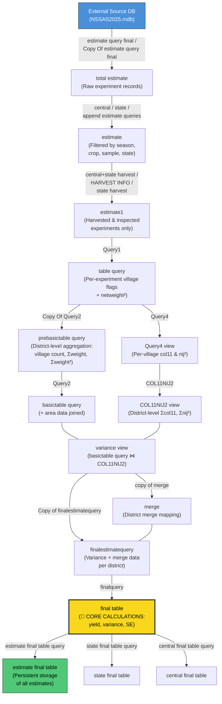
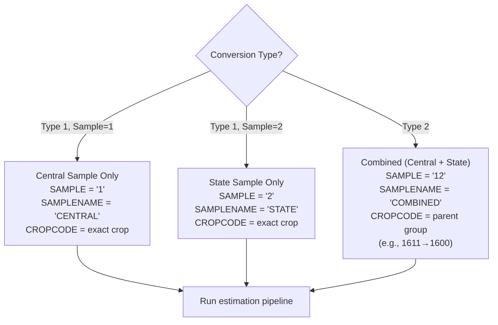
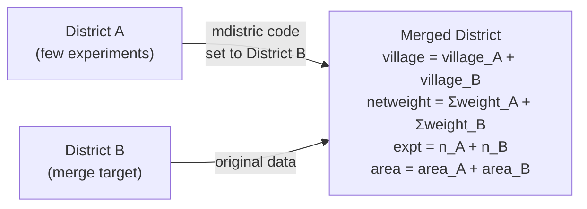

# NSO Crop Yield Estimation — Complete Calculation Workflow

## ESTIMATE.accdb — Analytical Documentation

> [!NOTE]
> This document analyses the **ESTIMATE.accdb** Microsoft Access database used by the **National Statistical Office (NSO), India** under the **Improvement of Crop Statistics (ICS) Scheme** to compute **Yield Rate (Kg/hectare)** and **Standard Error percentage (%SE)** for crop estimation surveys.

---

## 1. Overview & Context

The ICS scheme uses a **stratified multi-stage sampling design** where:
- **Districts** are strata
- **Villages** (Selection Orders) are first-stage units (FSU)
- **Crop Cutting Experiments (CCE)** within villages are second-stage units

The database automates the entire pipeline — from raw experiment data ingestion to the production of district-level and state-level yield estimates with their associated standard errors.

### Sample Types

| Sample Code | Name | Description |
|---|---|---|
| `1` | **Central** | Experiments supervised by NSO field staff |
| `2` | **State** | Experiments conducted by state agricultural departments |
| `12` | **Combined** | Pooled central + state sample |

---

## 2. High-Level Workflow



---

## 3. Data Ingestion Pipeline

### 3.1 Source: External Database (NSSAS2025.mdb)

The raw experiment data originates from the **AS2.0 data entry system** (`NSSAS2025.mdb` located at `C:\ICS_Scheme\AS2.0\AS2025\`). The key source tables in that external database are:

| External Table | Purpose |
|---|---|
| `EXPTMASTER` | Master list of all planned experiments (year, season, crop, sample, state, district, selection order, experiment number) |
| `Sch20Block1` | Inspection status (INSPSTATE) |
| `Sch20Block5p1` | Net weight of harvested produce (NETWEIGHT) in grams |
| `Sch20RC7` | Consolidated results: inspection staging, rejection, net weight, seed type, irrigation, fertilizer, manure, pesticide, crop condition, weather affectation |
| `Sch20Block8P1/P2` | Agricultural input details |
| `Sch20Block9P1` | Crop condition assessment |

### 3.2 Query: `estimate query` (Linked View)

```sql
SELECT EXPTMASTER.*, Sch20Block1.INSPSTATE, Sch20RC7.REJ, 
       Sch20Block5p1.NETWEIGHT, Sch20Block8P1.SEEDTYPE, ...
FROM EXPTMASTER 
  LEFT JOIN Sch20Block5p1 ON EXPTMASTER.EXPTID = Sch20Block5p1.EXPTID
  LEFT JOIN Sch20Block8P1 ...
  LEFT JOIN Sch20RC7 ...
WHERE Sch20Block8P1.SRLDESC = "s" 
  AND Sch20Block9P1.SRLDESC = "Experimental plot"
```

### 3.3 Query: `estimate query final` → `total estimate`

Joins `EXPTMASTER` with `Sch20RC7` and loads records into `total estimate` filtered by user-selected season, crop, sample, and state from the `query` form.

### 3.4 Filtering into `estimate` table

Depending on the **conversion type** selected:

| Conversion Type | Query Used | What It Does |
|---|---|---|
| Type 1, Central (sample=1) | `central` | Loads both central & state samples for the crop |
| Type 1, State (sample=2) | `state` | Loads state sample only |
| Type 2, Combined | `central` | Loads both samples, recodes crop to parent group (e.g., `1611` → `1600`) |

---

## 4. Data Filtering — Harvested Experiments

### 4.1 `estimate` → `estimate1`

The `estimate1` table contains **only successfully harvested experiments** — the subset that enters the statistical computation:

| Query | Filter Criteria |
|---|---|
| `central + state harvest` | `INSPSTATE = '1'` AND `REJ <> '1'` (inspected, not rejected) |
| `central harvest` | `SAMPLE IN (selected samples)` AND `INSPSTATE = '1'` |
| `state harvest` | `SAMPLE = '2'` AND `INSPSTATE = '1'` |
| `HARVEST INFO` | `INSPSTATE = '1'` (all samples, inspected only) |

> [!IMPORTANT]
> Only experiments with **INSPSTATE = '1'** (successfully inspected/harvested) and **REJ ≠ '1'** (not rejected) contribute to yield estimation. Missed, lost, not-received, and rejected experiments are excluded from the calculation but are still counted in summary statistics.

---

## 5. Village Identification & Per-Experiment Computation

### 5.1 Query1: `estimate1` → `table query`

This is the first computational step. For each experiment:

```sql
SELECT estimate1.STATE, estimate1.DISTRICT, estimate1.SELORDER, 
       estimate1.EXPT, estimate1.NETWEIGHT,
       [NETWEIGHT]^2 AS [netweight sqr],
       -- Village identification via selection order flags:
       [SELORDER]='01' AS [o/s1],
       [SELORDER]='02' AS [o/s2],
       ...
       [SELORDER]='30' AS [o/s30],
       -- Count how many village slots have experiments:
       IIf([o/s1]=-2 Or [o/s1]=-1,1,0) + ... AS [For nij]
INTO [table query]
FROM estimate1
```

**Key computations:**
- **`netweight sqr`** = $\text{NETWEIGHT}^2$ — squared net weight for variance computation
- **`o/s1` to `o/s30`** — Boolean flags (-1 = True in Access) indicating which selection order (village slot) this experiment belongs to
- **`For nij`** — count of village slots with at least one experiment (used to compute $n_{ij}$)

> [!NOTE]
> In MS Access, Boolean TRUE is stored as `-1` (or `-2` in some contexts). The `IIf([o/s1]=-2 Or [o/s1]=-1, 1, 0)` pattern converts these to 1/0 for counting.

---

## 6. District-Level Aggregation

### 6.1 `Copy Of Query2`: `table query` → `prebasictable query`

Aggregates experiment-level data to **district level**:

```sql
SELECT [table query].DISTRICT, [table query].DISTRICTNAME,
       -- Sum selection-order flags across experiments per district:
       Sum([o/s1]) AS [SumOfo/s1], ..., Sum([o/s30]) AS [SumOfo/s30],
       
       -- Village counts (groups of 12/12/6 selection orders):
       IIf([SumOfo/s1]=-2 Or [SumOfo/s1]=-1,1,0) + ... AS vil1,   -- Villages 1-12
       IIf([SumOfo/s13]=-2 Or ...] AS vil2,                         -- Villages 13-24
       IIf([SumOfo/s25]=-2 Or ...] AS vil3,                         -- Villages 25-30
       Nz([vil1],0) + Nz([vil2],0) + Nz([vil3],0) AS [total village],
       
       -- Statistical aggregates:
       Sum(NETWEIGHT)         AS SumOfNETWEIGHT,
       Sum([netweight sqr])   AS [SumOfnetweight sqr],
       Count(EXPT)            AS CountOfEXPT,
       
       -- Conversion factors from form:
       [Forms]![query]![driage ratio]       AS [driage ratio],
       [Forms]![query]![recovery ratio]     AS [recovery ratio],
       [Forms]![query]![conversion factor]  AS cf
INTO [prebasictable query]
FROM [table query]
GROUP BY DISTRICT, DISTRICTNAME, ...
```

**Key outputs per district:**

| Field | Symbol | Description |
|---|---|---|
| `total village` | $m_i$ | Number of villages with experiments in district $i$ |
| `SumOfNETWEIGHT` | $\sum y_{ij}$ | Sum of net weights across all experiments |
| `SumOfnetweight sqr` | $\sum y_{ij}^2$ | Sum of squared net weights |
| `CountOfEXPT` | $n_i$ | Total number of experiments in district |

### 6.2 Query2: `prebasictable query` → `basictable query`

Joins the district aggregates with **area data** from `areabasictablequery`:

```sql
SELECT [prebasictable query].*, areabasictablequery.area
INTO [basictable query]
FROM [prebasictable query] 
  LEFT JOIN areabasictablequery ON (DISTRICT, CROPCODE, SAMPLE, STATE, SEASONCODE)
```

The **area** ($A_i$) is the crop area sown in hectares for the district, essential for computing the weighted state-level estimate.

---

## 7. Within-Village Variance Components

### 7.1 Query4: Per-Selection-Order Computation

This query works at the **village (selection order) level** within each district:

```sql
SELECT [table query].SELORDER, [table query].DISTRICT,
       Count(EXPT) AS CountOfEXPT,                   -- nᵢⱼ (experiments per village)
       Sum([netweight sqr]) AS SumOfnetweight_sqr,     -- Σyᵢⱼₖ²
       Sum(NETWEIGHT) AS SumOfNETWEIGHT,               -- Σyᵢⱼₖ = col11_raw
       [SumOfNETWEIGHT]^2 AS [col11^2],               -- (Σyᵢⱼₖ)²
       [col11^2] / [CountOfEXPT] AS col11,            -- (Σyᵢⱼₖ)² / nᵢⱼ
       [CountOfEXPT] * [CountOfEXPT] AS nij2           -- nᵢⱼ²
FROM [table query]
GROUP BY SELORDER, DISTRICT, DISTRICTNAME
```

**Mathematical definitions:**

For village $j$ in district $i$, with $n_{ij}$ experiments having yields $y_{ijk}$:

$$\text{col11}_{ij} = \frac{\left(\sum_{k=1}^{n_{ij}} y_{ijk}\right)^2}{n_{ij}}$$

$$\text{nij2}_{ij} = n_{ij}^2$$

### 7.2 COL11NIJ2: District-Level Sums

```sql
SELECT DISTRICT, DISTRICTNAME,
       Sum(col11) AS SumOfcol11,    -- Σⱼ col11ᵢⱼ
       Sum(nij2)  AS SumOfnij2      -- Σⱼ nᵢⱼ²
FROM Query4
GROUP BY DISTRICT, DISTRICTNAME
```

$$\text{SumOfcol11}_i = \sum_{j=1}^{m_i} \frac{\left(\sum_k y_{ijk}\right)^2}{n_{ij}}$$

$$\text{SumOfnij2}_i = \sum_{j=1}^{m_i} n_{ij}^2$$

---

## 8. Variance View & Merge

### 8.1 `variance` view

Combines `basictable query` with `COL11NIJ2`:

```sql
SELECT [basictable query].*, COL11NIJ2.SumOfcol11, COL11NIJ2.SumOfnij2
FROM [basictable query] 
  INNER JOIN COL11NIJ2 ON (DISTRICT, DISTRICTNAME)
```

This creates the complete district-level statistical dataset.

### 8.2 `merge` table — District Merging

The merge table handles **district merging** — when small districts need to be combined with neighbouring districts for statistical reliability:

```sql
SELECT [basictable query].[mdistric code], [basictable query].[mdistric name],
       variance.[total village], variance.SumOfNETWEIGHT, ...
INTO merge
FROM [basictable query] LEFT JOIN variance ON [mdistric code] = DISTRICT
```

When `mdistric code` is set for a district, its data gets merged with the target district.

### 8.3 `finalestimatequery` — Combined Variance + Merge

```sql
SELECT variance.DISTRICT, ..., 
       variance.* AS variance_*,    -- Original district data
       merge.* AS merge_*           -- Merged district data (if any)
INTO finalestimatequery
FROM merge LEFT JOIN variance ON [mdistric code] = variance.[mdistric code]
```

---

## 9. Core Calculations — `finalquery`

> [!IMPORTANT]
> This is the **heart of the estimation system**. The `finalquery` query computes all statistical measures from `finalestimatequery` and writes the results into `final table`.

### 9.1 Field-by-Field Computation

The query produces one row per district with the following computed fields. All district merging is applied first by combining variance and merge data:

```sql
SELECT finalestimatequery.*,
  -- Combined district totals (variance + merge):
  Nz(variance_total_village, 0) + Nz(merge_total_village, 0)       AS village,
  Nz(variance_SumOfNETWEIGHT, 0) + Nz(merge_SumOfNETWEIGHT, 0)   AS netweight,
  Nz(variance_SumOfnetweight_sqr, 0) + Nz(merge_SumOfnetweight_sqr, 0) AS netweight2,
  Nz(variance_CountOfEXPT, 0) + Nz(merge_CountOfEXPT, 0)         AS expt,
  ... area, cf (similarly combined) ...,
  
  -- Composite Conversion Factor:
  [variance_driage_ratio] * [variance_recovery_ratio] * [cf]       AS ccf,
  
  -- Combined variance components:
  Nz(variance_SumOfcol11, 0) + Nz(merge_SumOfcol11, 0)           AS col11,
  Nz(variance_SumOfnij2, 0) + Nz(merge_SumOfnij2, 0)             AS nij2,
  
  -- Degrees of freedom:
  IIf([village]=0, 0, [village]-1)                                 AS [mi-1],
  [expt] - [village]                                               AS [ni-mi],
  
  -- Variance ratio (i):
  IIf([expt]=0, 0, Round(([expt]^2 - [nij2]) / ([expt]*[mi-1]), 2)) AS i,
  
  -- Weighted area squared:
  IIf([expt]=0, 0, Round(([area]^2 / [expt]), 0))                 AS [ai2/ni],
  
  -- Variance component (col9):
  IIf([expt]=0, 0, Round(([area]^2 * [nij2]) / ([expt] * [i]), 0)) AS col9,
  
  -- Average Green Yield (grams per experiment plot):
  IIf([expt]=0, 0, Round(([netweight] / [expt]), 0))              AS agreenyield,
  
  -- Average Dry Yield (Kg per hectare):
  IIf([expt]=0, 0, Round(([agreenyield] * [ccf]), 0))             AS dryyield,
  
  -- Yield × Area:
  IIf([expt]=0, 0, ([dryyield] * [area]))                         AS [avy*area],
  
  -- Sum of squares check (col12):
  IIf([expt]=0, 0, Round(([netweight]^2) / [expt], 0))            AS col12,
  
  -- Data presence check:
  IIf([expt] > 0, 2, 0)                                           AS check
INTO [final table]
FROM finalestimatequery, [basic name]
```

---

## 10. Mathematical Formulas

### 10.1 Notation

| Symbol | Database Field | Meaning |
|---|---|---|
| $i$ | — | District index |
| $j$ | SELORDER | Village (selection order) index within district |
| $k$ | EXPT | Experiment index within village |
| $m_i$ | `village` | Number of sampled villages in district $i$ |
| $n_i$ | `expt` | Total number of experiments in district $i$ |
| $n_{ij}$ | (from Query4) | Number of experiments in village $j$ of district $i$ |
| $y_{ijk}$ | NETWEIGHT | Net weight (grams) from experiment $k$ in village $j$ of district $i$ |
| $A_i$ | `area` | Crop area (hectares) in district $i$ |
| $d$ | `driage ratio` | Driage ratio (green → dry weight conversion) |
| $r$ | `recovery ratio` | Recovery ratio |
| $f$ | `cf` | Conversion factor (plot area → hectare) |

### 10.2 Composite Conversion Factor (CCF)

$$\text{CCF} = d \times r \times f$$

This converts the raw green weight from the experiment plot to **dry yield per hectare**.

- **Driage ratio** ($d$): Fraction of dry weight to green weight (e.g., 0.688 for paddy)
- **Recovery ratio** ($r$): Accounts for processing losses (often 1.0)
- **Conversion factor** ($f$): Converts plot-level yield to per-hectare yield, based on the standard plot size

### 10.3 Average Green Yield (per experiment plot)

$$\bar{y}_i^{(\text{green})} = \frac{\sum_{j=1}^{m_i} \sum_{k=1}^{n_{ij}} y_{ijk}}{n_i} = \frac{\text{netweight}}{\text{expt}}$$

> Database field: `agreenyield`

### 10.4 Average Dry Yield (Kg per hectare)

$$\boxed{\bar{y}_i^{(\text{dry})} = \bar{y}_i^{(\text{green})} \times \text{CCF} = \frac{\text{netweight}}{\text{expt}} \times d \times r \times f}$$

> Database field: `dryyield`

This is the **primary output** — the estimated yield rate in Kg/hectare for each district.

### 10.5 Variance Components

#### Step 1: Per-village sum of yields squared, normalized

$$\text{col11}_{ij} = \frac{\left(\sum_{k=1}^{n_{ij}} y_{ijk}\right)^2}{n_{ij}}$$

#### Step 2: District-level sums

$$C_i = \sum_{j=1}^{m_i} \text{col11}_{ij} = \text{SumOfcol11}$$

$$Q_i = \sum_{j=1}^{m_i} n_{ij}^2 = \text{SumOfnij2}$$

#### Step 3: Variance scaling factor ($\hat{\imath}_i$)

$$\hat{\imath}_i = \frac{n_i^2 - Q_i}{n_i \times (m_i - 1)}$$

> Database field: `i`

This term accounts for unequal sub-sampling (different number of experiments across villages). When all villages have the same number of experiments ($n_{ij} = n_i/m_i$), this simplifies to $n_i/m_i$.

#### Step 4: Area-weighted variance component

$$\frac{A_i^2}{n_i}$$

> Database field: `ai2/ni`

$$\text{col9}_i = \frac{A_i^2 \times Q_i}{n_i \times \hat{\imath}_i}$$

> Database field: `col9`

#### Step 5: Col12 — Total squared yield

$$\text{col12}_i = \frac{\left(\sum_j \sum_k y_{ijk}\right)^2}{n_i} = \frac{\text{netweight}^2}{\text{expt}}$$

---

## 11. State-Level Aggregation & Standard Error

### 11.1 State-Level Yield

The state-level yield is computed as an **area-weighted average** across districts:

$$\bar{Y}_{\text{state}} = \frac{\sum_i \bar{y}_i^{(\text{dry})} \times A_i}{\sum_i A_i} = \frac{\sum_i (\text{avy} \times \text{area})_i}{\sum_i A_i}$$

### 11.2 Variance of State-Level Estimate

The variance formula follows from the **two-stage sampling design** (villages → experiments):

$$\text{Var}(\bar{Y}) = \frac{1}{\left(\sum_i A_i\right)^2} \sum_i A_i^2 \left[ \frac{\sum_{j} \sum_{k} y_{ijk}^2 - C_i}{n_i - m_i} - \frac{\hat{\imath}_i \left(\sum_j \sum_k y_{ijk}^2 - \text{col12}_i\right)}{n_i(m_i-1)} + \frac{\hat{\imath}_i \cdot C_i - \text{col9}_i}{n_i(m_i-1)} \right]$$

Which simplifies using the intermediate columns to:

$$\text{Var}(\bar{Y}) \approx \frac{1}{(\sum A_i)^2} \sum_i \left[\frac{A_i^2}{n_i} \cdot \frac{\text{netweight2}_i - C_i}{n_i - m_i}\right]$$

Where:
- $\text{netweight2}_i = \sum y_{ijk}^2$
- The between-village and within-village variance components are captured through the $C_i$, $Q_i$, and $\hat{\imath}_i$ terms.

### 11.3 Standard Error Percentage (%SE)

$$\boxed{\%\text{SE} = \frac{\sqrt{\text{Var}(\bar{Y})}}{\bar{Y}_{\text{state}}} \times 100}$$

> [!TIP]
> The %SE is the **coefficient of variation** of the yield estimate. NSO typically expects %SE < 10% for a reliable state-level estimate. High %SE values indicate either insufficient sample size or high variability across districts/villages.

---

## 12. Data Flow — Complete Pipeline

```mermaid
flowchart LR
    subgraph "1. Data Source"
        EXT["NSSAS2025.mdb<br/>Raw CCE Data"]
    end

    subgraph "2. Data Loading"
        TE["total estimate"]
        EST["estimate<br/>(filtered)"]
        EST1["estimate1<br/>(harvested only)"]
    end

    subgraph "3. Per-Experiment"
        TQ["table query<br/>netweight², village flags"]
    end

    subgraph "4. District Aggregation"
        PBT["prebasictable query<br/>Σweight, Σweight², village count"]
        BT["basictable query<br/>+ area data"]
        Q4["Query4<br/>per-village col11, nij²"]
        C11["COL11NIJ2<br/>Σcol11, Σnij²"]
    end

    subgraph "5. Merge & Combine"
        VAR["variance view"]
        MRG["merge"]
        FEQ["finalestimatequery"]
    end

    subgraph "6. Core Computation"
        FT["final table<br/>yield, variance, SE"]
    end

    subgraph "7. Output"
        EFT["estimate final table"]
        SFT["state final table"]
        CFT["central final table"]
    end

    EXT --> TE --> EST --> EST1 --> TQ
    TQ --> PBT --> BT
    TQ --> Q4 --> C11
    BT --> VAR
    C11 --> VAR
    VAR --> MRG
    VAR --> FEQ
    MRG --> FEQ
    FEQ --> FT
    FT --> EFT
    FT --> SFT
    FT --> CFT
```



---

## 13. Conversion Type Handling

The system supports three modes of operation:



### Crop Code Grouping (Type 2)

For combined estimates, individual crop codes are mapped to their **parent crop group**:

$$\text{CROPCODE}_{\text{combined}} = \text{Left}(\text{CROPCODE}, 2) \mathbin\Vert \text{'00'}$$

Example: `1611` (Samba Paddy) → `1600` (All Paddy)

---

## 14. District Merging Logic

When a district has too few experiments for a reliable estimate, it can be **merged** with another district:



**In the `finalquery`:**

```
village   = Nz(variance_total_village, 0) + Nz(merge_total_village, 0)
netweight = Nz(variance_SumOfNETWEIGHT, 0) + Nz(merge_SumOfNETWEIGHT, 0)
expt      = Nz(variance_CountOfEXPT, 0) + Nz(merge_CountOfEXPT, 0)
area      = Nz(Val(variance_area), 0) + Nz(Val(merge_area), 0)
```

If `mdistric code = '1'`, all computed values are set to **0** (district excluded from computation).

---

## 15. Information & Accompaniment Sheet

The `CURRENTINFORMATIONACCOMP` query generates a statistical summary for the **Information Accompaniment Sheet** (Page 1 of the estimate report):

| Category | Fields | Source |
|---|---|---|
| **Experiment Status** | Analysed, Missed, Lost, Rejected, NR | `DCount` on `estimate` table |
| **Yield Distribution** | 0-1000, 1000-5000, ..., >25000 grams | `DCount` on `estimate1` by NETWEIGHT ranges |
| **Agricultural Inputs** | Irrigated, HYV, Fertilizer, Manure, Pesticide | `DCount` on `estimate1` by input codes |
| **Crop Condition** | Good, Normal, Below Normal, Damaged | `DCount` on `estimate1` by CROPCOND |
| **Weather Affectation** | Heavy Rain, Flood, Drought, Pests, Others | `DCount` on `estimate1` by AFF codes |

---

## 16. Summary of Key Formulas

| Output | Formula | Database Field |
|---|---|---|
| **Green Yield** | $\bar{y}^{(g)} = \frac{\sum y_{ijk}}{n}$ | `agreenyield` |
| **CCF** | $\text{CCF} = d \times r \times f$ | `ccf` |
| **Dry Yield (Kg/ha)** | $\bar{y}^{(d)} = \bar{y}^{(g)} \times \text{CCF}$ | `dryyield` |
| **Variance factor** | $\hat{\imath} = \frac{n^2 - \sum n_{ij}^2}{n(m-1)}$ | `i` |
| **Village count** | $m$ = count of villages with experiments | `village` |
| **Degrees of freedom** | $m - 1$ | `mi-1` |
| **Within-village df** | $n - m$ | `ni-mi` |
| **Area²/n** | $A^2/n$ | `ai2/ni` |
| **Variance component** | $\frac{A^2 \cdot \sum n_{ij}^2}{n \cdot \hat{\imath}}$ | `col9` |
| **Yield × Area** | $\bar{y}^{(d)} \times A$ | `avy*area` |
| **Col12** | $\frac{(\sum y_{ijk})^2}{n}$ | `col12` |

> [!CAUTION]
> The database stores NETWEIGHT in **grams**. The conversion to **Kg/hectare** is handled entirely by the CCF (composite conversion factor). If the driage ratio, recovery ratio, or conversion factor are incorrectly entered, the yield estimate will be wrong. Always verify these parameters before running the estimation.

---

## 17. Database Object Inventory

### Tables (22)

| Table | Role |
|---|---|
| `total estimate` / `total estimate final` | Raw experiment records (permanent + working) |
| `estimate` | Working copy, filtered by selection criteria |
| `estimate1` | Harvested experiments only |
| `table query` | Per-experiment with village flags and weight² |
| `prebasictable query` | District aggregation (pre-area join) |
| `basictable query` | District aggregation (with area) |
| `areabasictablequery` | District crop areas |
| `merge` | District merge mapping |
| `finalestimatequery` | Combined variance + merge data |
| `final table` | Core computation results (working) |
| `estimate final table` | Core computation results (permanent) |
| `state final table` | State sample results |
| `central final table` | Central sample results |
| `basic name` | Report header info (year, season, crop, state) |
| `query` | User input parameters |
| `area p1` / `area p1 pre` / `areap` | Information accompaniment data |
| `info setting` | Pooled estimate settings |
| `SETTINGS` / `id iinfo` | Application settings |

### Queries (35+)

Categorized by type:

| Type | Queries |
|---|---|
| **SELECT (Views)** | `COL11NIJ2`, `estimate query`, `EXPTMASTER Query`, `Query4`, `variance` |
| **Make Table** | `Query1`, `Copy Of Query2`, `Query2`, `basic name query`, `central`, `state`, `central+state`, `finalquery`, `Copy of finalestimatequery`, `copy of merge`, `central/state final table query`, `HARVEST INFO`, `CURRENTINFORMATIONACCOMP` |
| **Append** | `append estimate` (1-4), `estimate query final`, `Copy Of estimate query final`, `INFO TOTAL ESTIMATE`, `areabasictable`, `areap1-4`, `estimate final table query`, `query total estimate final` |
| **Delete** | `DELETE estimate`, `DELETE AREA P1`, `delete areap`, `delete estimate final table`, `delete total estimate`, `DELETE TOTAL ESTIMATE FINAL TABLE`, `delareabasictablequery`, `delquery` |

### Forms (17)

| Form | Purpose |
|---|---|
| `START` / `FIRST PAGE` / `PAGE2` | Navigation |
| `query` | Main parameter input (season, crop, sample, state, conversion type, ratios) |
| `query combined` | Combined estimate parameters |
| `info setting` | Pooled estimate settings |
| `estimate` / `estimate info` | View estimate data |
| `INFO` / `information` / `information a` / `informatation accompaying` / `injformation accompaying` | Information accompaniment sheets |
| `area estimate` / `area estimate1` | Area data management |
| `Form1` / `CLOSE FORM` | Utility forms |

---

## 18. Worked Example

Using sample data from the database (ERNAKULAM district, PADDY, AUTUMN 2018-19, Central sample, Kerala):

| Step | Field | Value |
|---|---|---|
| Villages with experiments | `village` ($m_i$) | 5 |
| Total experiments | `expt` ($n_i$) | 10 |
| Sum of net weights | `netweight` ($\sum y$) | 98,337 g |
| Sum of weight² | `netweight2` ($\sum y^2$) | 1,958,770,889 |
| Driage ratio | $d$ | 0.688 |
| Recovery ratio | $r$ | 1.000 |
| Conversion factor | $f$ | 0.52 |
| **CCF** | $d \times r \times f$ | **0.35776** |
| $\sum \text{col11}$ | | 1,379,744,914.5 |
| $\sum n_{ij}^2$ | `nij2` | 20 |
| $m_i - 1$ | `mi-1` | 4 |
| $n_i - m_i$ | `ni-mi` | 5 |
| Variance factor | $\hat{\imath} = \frac{100 - 20}{10 \times 4} = 2.0$ | 2.0 |
| $A_i^2 / n_i$ | `ai2/ni` | 25,000 |
| col9 | $\frac{500^2 \times 20}{10 \times 2} = 250{,}000$ | 250,000 |
| **Green Yield** | $98337 / 10$ | **9,834 g/plot** |
| **Dry Yield** | $9834 \times 0.35776$ | **3,518 Kg/ha** |
| `avy*area` | $3518 \times 500$ | 1,759,000 |
| col12 | $98337^2 / 10$ | 967,016,557 |

---

*Document generated from analysis of [ESTIMATE.accdb](file:///d:/05 GIT/26-NSO-Estimate-MDB-to-Py/01_Estimate_Workflow_in_mdb/ASSOFTWARE/ESTIMATE.accdb)*
